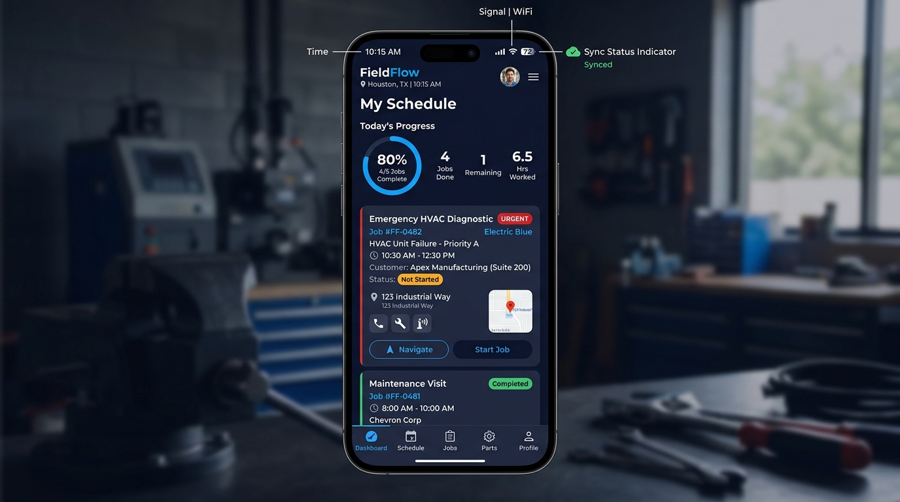
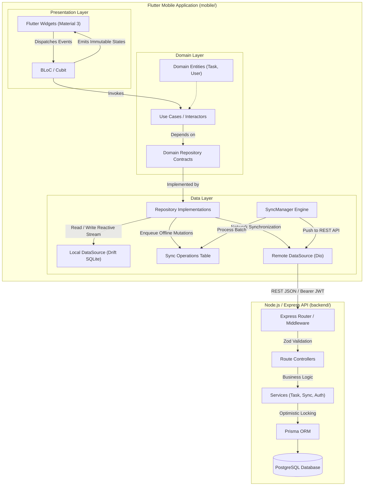
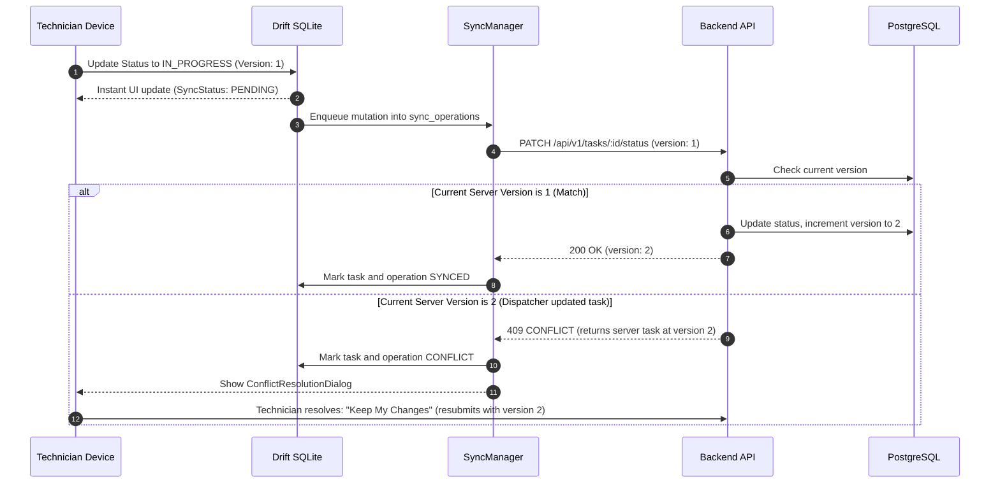

# field_flow
# FIELDFlow
### Offline-First Field Service Management Platform

A new Flutter project.
[](https://github.com/amrit/fieldflow/actions)
[](https://flutter.dev)
[](https://dart.dev)
[](https://www.typescriptlang.org/)
[](https://nodejs.org/)
[](https://www.postgresql.org/)
[](https://www.prisma.io/)
[](https://opensource.org/licenses/MIT)

## Getting Started
<p align="center">
  
</p>

This project is a starting point for a Flutter application.
**FIELDFlow** is an enterprise-grade mobile application and REST backend platform built for field service technicians, installation engineers, and maintenance personnel. Designed from the ground up as **offline-first**, technicians can accept tasks, transition job statuses, document diagnostic notes, record GPS location stamps, and capture photos in underground equipment rooms, basements, or remote job sites with zero cellular connectivity.

A few resources to get you started if this is your first Flutter project:
Once connectivity returns, an intelligent **Background Synchronization Engine** automatically dispatches queued mutations using **exponential backoff**, isolates errors, and detects optimistic concurrency conflicts (**HTTP 409 Conflict**), providing technicians with a visual reconciliation interface rather than silently overwriting server updates.

- [Learn Flutter](https://docs.flutter.dev/get-started/learn-flutter)
- [Write your first Flutter app](https://docs.flutter.dev/get-started/codelab)
- [Flutter learning resources](https://docs.flutter.dev/reference/learning-resources)
---

For help getting started with Flutter development, view the
[online documentation](https://docs.flutter.dev/), which offers tutorials,
samples, guidance on mobile development, and a full API reference.
## 🌟 Key Features

- 📱 **Offline-First Architecture**: 100% of UI reads and writes interact directly with a reactive local SQLite database (powered by Drift). The app never blocks on network connectivity.
- 🔄 **Intelligent Sync Engine**: Background queue monitoring with exponential backoff (`2s`, `4s`, `8s`, `16s`, max 5 retries), batch operation packaging, and atomic processing.
- ⚠️ **Optimistic Concurrency & Conflict UI**: Version-tagged entity mutations. Stale client updates trigger `HTTP 409 Conflict` and present an interactive diff resolution dialog (`Keep My Changes` vs `Accept Server Version`).
- 📊 **Executive Technician Dashboard**: Real-time KPI summary (Completed, In Progress, Pending), circular completion rate gauge, persistent live synchronization status badge, and prioritized job feeds.
- 🛡️ **Validated Task State Machine**: Enforces strict operational transitions (`ASSIGNED` → `ACCEPTED` → `IN_PROGRESS` → `COMPLETED`). Invalid leaps or post-completion mutations are rejected at both client and server layers.
- 🗺️ **Open-Source Interactive Mapping**: Zero paid API dependencies. Modular map component utilizing OpenStreetMap with technician GPS breadcrumbs, customer pins, and turn-by-turn navigation triggers.
- 🤖 **Local AI Troubleshooting Assistant**: Pluggable diagnostic assistant integrating with local **Ollama** (`llama3` / `mistral`) with an automatic offline rule-based expert diagnostic engine fallback for zero-cost operation.
- 🔐 **Enterprise Security & Session Management**: JWT access (15 min) and refresh tokens (7 days). Secure token storage via hardware-backed keystore (`flutter_secure_storage`). Automatic silent 401 token refresh interceptor.
- 🧪 **Thorough Test Coverage**: Unit tests (Auth, Task transitions, Sync engine backoff), Widget tests (Task card, Network status bar, Conflict modal), and an End-to-End integration test simulating an offline service visit from arrival to sync.

---

## 🏗️ Architecture & Design Patterns

FIELDFlow follows **Clean Architecture** and **SOLID** principles:



### Optimistic Concurrency & Conflict Flow



---

## 💻 Tech Stack Matrix

| Component | Technology | Rationale |
|---|---|---|
| **Mobile Framework** | Flutter 3.27+ / Dart 3.2+ | Cross-platform native compilation with high rendering performance |
| **State Management** | `flutter_bloc` & `equatable` | Predictable, unidirectional, testable immutable state flows |
| **Local Persistence** | `drift` + `sqlite3_flutter_libs` | Type-safe, reactive SQLite streams with built-in migration support |
| **Network Client** | `dio` + custom Interceptors | Automated 401 token refresh queue, retry handling, and error mapping |
| **Navigation** | `go_router` 14.x | Declarative routing with deep linking and reactive auth redirect guards |
| **Secure Storage** | `flutter_secure_storage` | Encrypted hardware keystore / Keychain for JWT tokens |
| **Mapping** | `flutter_map` + `latlong2` | Free OpenStreetMap raster tiles (Zero paid API keys needed) |
| **Hardware & Sensors** | `geolocator`, `image_picker` | GPS coordinate tagging and camera image capture |
| **Notifications** | `flutter_local_notifications` | Push notification abstraction and dispatch alerts |
| **Backend API** | Node.js 20+ / TypeScript / Express | Enterprise REST architecture with strict typing |
| **ORM & Database** | Prisma ORM + PostgreSQL 16 | Declarative schemas, type-safe queries, and transactional optimistic locking |
| **Authentication** | JWT (jsonwebtoken) + bcryptjs | Short-lived access tokens (15m) + long-lived refresh tokens (7d) |
| **Validation** | Zod | Request body, query parameter, and environment schema validation |
| **Local AI** | Ollama (`llama3`) | Self-hosted, private technical troubleshooting assistant |
| **DevOps** | Docker Compose + GitHub Actions | Instant local containerization and automated CI test execution |

---

## 🚀 Quick Start Guide

### Prerequisites
- [Flutter SDK](https://flutter.dev/docs/get-started/install) (`>= 3.2.0`)
- [Node.js](https://nodejs.org/) (`>= 20.x`) and `npm`
- [Docker](https://www.docker.com/) & Docker Compose (or local PostgreSQL)
- *(Optional)* [Ollama](https://ollama.com/) for local AI diagnosis

---

### Step 1: Database & Backend Setup

1. Navigate to the `backend/` directory:
   ```bash
   cd backend
   ```
2. Install dependencies:
   ```bash
   npm install
   ```
3. Configure environment variables:
   ```bash
   cp .env.example .env
   ```
4. Start PostgreSQL:
   ```bash
   # Option A: Start with Docker Compose from repository root
   docker compose up -d postgres

   # Option B: Use an existing PostgreSQL database and update DATABASE_URL in backend/.env
   ```
5. Apply database schema and generate Prisma client:
   ```bash
   npx prisma db push
   ```
6. Seed realistic development data (1 Admin, 2 Workers, 22 Tasks, Notes, Locations, Alerts):
   ```bash
   npm run prisma:seed
   ```
7. Start the backend REST server:
   ```bash
   npm run dev
   ```
   *The server will start at `http://localhost:5000` (Healthcheck: `http://localhost:5000/api/v1/health`)*

---

### Step 2: Mobile Application Setup

1. Open a new terminal in the `mobile/` directory:
   ```bash
   cd mobile
   ```
2. Get Flutter dependencies:
   ```bash
   flutter pub get
   ```
3. Run code analysis:
   ```bash
   flutter analyze
   ```
4. Run all unit, widget, and integration tests:
   ```bash
   flutter test
   ```
5. Launch the application:
   ```bash
   flutter run
   ```
   *For Android Emulator, base URL automatically defaults to `http://10.0.2.2:5000/api/v1`.*

---

### Step 3: (Optional) Local AI Assistant Setup

To enable the local Ollama LLM:
```bash
# Start Ollama server
ollama serve

# Pull the model in another terminal
ollama run llama3
```
*Note: If Ollama is not running, the application automatically activates its built-in **Field Diagnostics Expert Engine**, ensuring complete offline functionality.*

---

## 🔑 Demo Credentials

The database seed script creates realistic technician accounts pre-loaded with assigned jobs:

| Role | Email | Password | Assigned Jobs |
|---|---|---|---|
| **Field Technician 1** *(Primary)* | `worker@example.com` | `password123` | 17 Active & Scheduled Tasks |
| **Field Technician 2** | `worker2@example.com` | `password123` | 5 Active Tasks |
| **System Administrator** | `admin@fieldflow.dev` | `admin123` | Global Task & User Management |

*(The login screen also features one-tap quick-fill buttons for instant demo access)*

---

## 🧪 Testing Suite

### Mobile Tests (`mobile/`)
Run all tests:
```bash
cd mobile
flutter test
```

Test Breakdown:
- `test/unit/auth/auth_bloc_test.dart`: Session verification, token refresh, login failures.
- `test/unit/tasks/task_status_transition_test.dart`: Validates strict state transitions and rejects illegal status jumps.
- `test/unit/sync/sync_manager_test.dart`: Tests exponential backoff intervals (`2s`, `4s`, `8s`, `16s`) and max retry caps.
- `test/widget/task_card_test.dart`: Verifies card metadata, priority badge styling, and tap actions.
- `test/widget/sync_status_widget_test.dart`: Verifies online, offline, and syncing banner variations.
- `test/widget/conflict_dialog_test.dart`: Tests side-by-side local vs remote comparison and resolution triggers.
- `test/integration/offline_sync_flow_test.dart`: Comprehensive simulation of taking a device offline, completing a job in SQLite, restoring connection, and verifying batch sync.

### Backend Tests (`backend/`)
Run unit tests:
```bash
cd backend
npm test
```

---

## 📚 Documentation Reference

- **[System Architecture Guide](docs/ARCHITECTURE.md)**: Deep dive into Clean Architecture layers, dependency inversion, and component responsibilities.
- **[Offline Sync Engine Specification](docs/OFFLINE_SYNC_ENGINE.md)**: Full breakdown of SQLite queueing, exponential backoff, and optimistic concurrency.
- **[REST API Documentation](docs/API_DOCUMENTATION.md)**: Complete endpoint contracts, request/response payloads, and error codes.

---

## 🔮 Future Roadmap

- [ ] End-to-End WebSocket notification stream for live dispatcher reassignment.
- [ ] Vector database embedding for on-device PDF equipment manual semantic search.
- [ ] Bluetooth Low Energy (BLE) sensor telemetry ingestion from industrial multimeters.
- [ ] Signature capture pad for customer sign-off stored as encrypted SVG/PNG.

---

## 📄 License

This project is licensed under the MIT License - see the [LICENSE](LICENSE) file for details.
