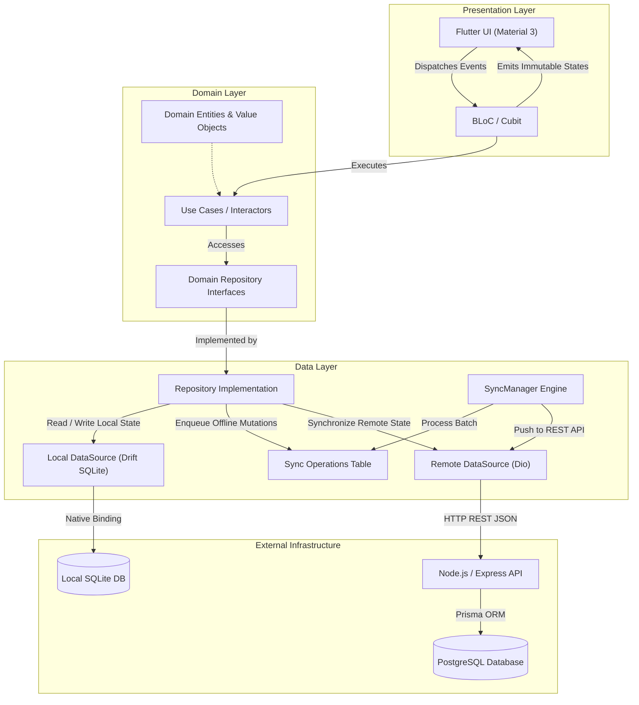

# FIELDFlow System Architecture

FIELDFlow is architected using **Clean Architecture** principles and the **Repository Pattern** to decouple user interface concerns from business logic, data persistence, and network transport layers.

---

## 1. High-Level Architectural Flow



---

## 2. Mobile Clean Architecture Layers

### Presentation Layer
- **Pages**: Top-level route destinations (e.g. `TaskListPage`, `TaskDetailsPage`, `SyncCenterPage`, `AiAssistantPage`).
- **Widgets**: Reusable presentational components (`TaskCard`, `StatusBadge`, `PriorityChip`, `NetworkStatusBar`, `SkeletonLoader`).
- **BLoCs / Cubits**: Pure business logic components handling UI states, events, and side-effects. Widgets never make direct database or HTTP calls.

### Domain Layer
- **Entities**: Business models (`Task`, `User`, `TroubleshootingAdvice`, `TaskStatus`, `Priority`).
- **Repositories**: Abstract contracts establishing dependency inversion.
- **Use Cases**: Single-responsibility interactors orchestrating domain operations (`GetTasksUseCase`, `UpdateTaskStatusUseCase`, `LoginUseCase`).

### Data Layer
- **Data Sources**:
  - `TaskLocalDataSource`: Reactive queries against Drift SQLite database.
  - `TaskRemoteDataSource`: Network requests via configured Dio `ApiClient`.
  - `OllamaDataSource`: Communication with local Ollama LLM endpoint.
  - `RuleBasedFieldExpert`: Deterministic fallback diagnostics engine.
- **Models**: Data Transfer Objects (DTOs) with JSON and Drift table serialization.
- **Repository Implementations**: Coordinates local cache with remote sync.

---

## 3. Backend Architecture

The backend is built with **Node.js, TypeScript, Express, and Prisma ORM**:

```
backend/src/
├── config/         # Environment variable validation (Zod) & Prisma database client
├── controllers/    # Request handling and HTTP response formatting
├── middleware/     # JWT authentication, role guards, error handling, file uploads
├── routes/         # REST API route aggregation under /api/v1
├── services/       # Core business logic, status transition validation, sync batching
├── validators/     # Zod request validation schemas
└── utils/          # Standardized response helpers, AppError, logger, JWT sign/verify
```

### Key Principles:
- **Centralized Error Handling**: Unhandled exceptions are intercepted and converted into standardized error payloads with HTTP status codes.
- **Atomic Operations**: Status updates and version increments execute within database transactions.
- **No Stack Traces in Production**: Security hardening ensures system internals are never exposed.
