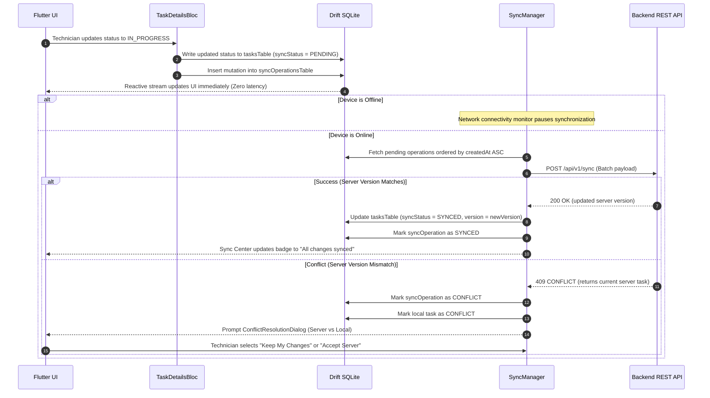

# FIELDFlow Offline-First Synchronization Engine

The offline-first architecture guarantees that field technicians can perform all mission-critical job functions without an internet connection. The UI reads and writes exclusively to the local SQLite database via Drift.

---

## 1. Offline Mutation Lifecycle



---

## 2. Synchronization Queue (`sync_operations`)

Every offline mutation produces an entry in the SQLite `sync_operations` table:

| Field | Type | Description |
|---|---|---|
| `id` | TEXT | Unique UUID generated on the client |
| `operationType` | ENUM | `CREATE`, `UPDATE`, `DELETE` |
| `entityType` | ENUM | `TASK`, `NOTE`, `PHOTO`, `LOCATION` |
| `entityId` | TEXT | Primary key of the affected entity |
| `payload` | TEXT | Serialized JSON payload containing mutation data & client version |
| `status` | ENUM | `PENDING`, `SYNCED`, `FAILED`, `CONFLICT` |
| `retryCount` | INTEGER | Number of attempted retries |
| `lastError` | TEXT | Descriptive error message from last attempt |
| `createdAt` | DATETIME | Timestamp when technician performed action |
| `updatedAt` | DATETIME | Timestamp of last synchronization attempt |

---

## 3. Exponential Backoff & Retry Logic

When network requests fail due to transient connectivity drops or server timeouts, `SyncManager` calculates retry delays using exponential backoff:

$$\text{Delay} = 2^{\min(\text{retryCount}, 4)} \text{ seconds}$$

| Retry Attempt | Delay |
|---|---|
| Retry 1 | 2 seconds |
| Retry 2 | 4 seconds |
| Retry 3 | 8 seconds |
| Retry 4 | 16 seconds |
| Retry 5+ | Capped at 16 seconds (marked FAILED after 5 retries) |

Permanent errors (e.g., entity deleted on server) are marked `FAILED` immediately to avoid queue clogging.

---

## 4. Conflict Resolution (Optimistic Concurrency)

1. When updating a task, the client sends `{ status: "COMPLETED", version: 2 }`.
2. The server compares the submitted version against the current database version.
3. If a dispatcher or another technician modified the task in the meantime (server is at version 3), the backend returns:
   ```json
   {
     "success": false,
     "error": {
       "code": "CONFLICT",
       "message": "Task has been updated on the server. Please resolve conflict.",
       "details": {
         "serverTask": { "version": 3, "status": "CANCELLED" },
         "clientVersion": 2,
         "currentVersion": 3
       }
     }
   }
   ```
4. The client halts the mutation, flags the task as `CONFLICT`, and presents the `ConflictResolutionDialog` showing a side-by-side comparison of local and remote states.
5. The technician can choose:
   - **Accept Server Version**: Replaces local state with remote changes.
   - **Keep My Changes**: Overrides server version using the incremented version token.
